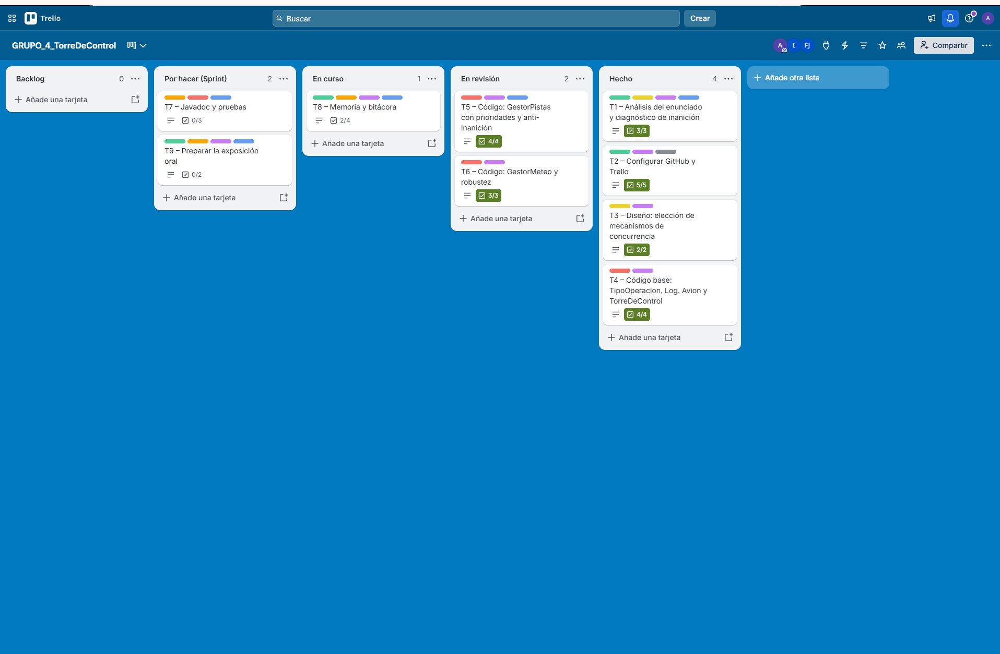

# GRUPO_4_TorreDeControl — Memoria

**Equipo de Torre de Control (Aeropuerto con Emergencias)**\
Integrantes: Iván, Alberto y Fabio — 2º DAM, PSP, UT2\
Repositorio Git: https://github.com/fabioporceldev/Grupo_4_TorreDeControl\
Tablero Trello: https://trello.com/b/O6XuzVoZ/grupo4torredecontrol

---

## 1. El problema

El aeropuerto tiene **2 pistas compartidas** por las que compiten **12 hilos `Avion`**. Cada maniobra dura **3 segundos**. Hay tres niveles de prioridad:

1. Aterrizaje de emergencia
2. Aterrizaje normal
3. Despegue

Hay dos reglas añadidas:

- **Anti-inanición:** tras 3 aterrizajes consecutivos, se deja salir al menos 1 despegue que esté esperando.
- **Evento meteorológico:** a los 10 s, el hilo `GestorMeteo` cierra la Pista 2 durante 8 s por viento cruzado.

## 2. Diagnóstico: por qué una cola de prioridad simple provoca inanición

Si metemos todas las peticiones en una cola de prioridad simple (por ejemplo, `PriorityBlockingQueue`), siempre sale primero el avión con mayor prioridad. Un despegue (prioridad 3) solo conseguiría pista cuando **no quedara ningún aterrizaje esperando**. Si los aterrizajes van llegando sin parar, el despegue no sale nunca, aunque las pistas se vayan liberando. Esto es **inanición (starvation)**: el hilo no está bloqueado por un error, pero nunca llega a ejecutar su trabajo porque siempre hay otro "más importante".

Por eso no dejamos la decisión a la cola, sino a un algoritmo propio (`siguienteEnTurno()`), que aplica la regla anti-inanición.

## 3. Diseño del gestor de pistas

### Clases

| Clase | Qué es | Papel en la concurrencia |
|---|---|---|
| `TorreDeControl` | `main` | Crea el gestor, el meteo y los 12 aviones; los arranca y espera con `join()` |
| `GestorPistas` | Monitor (recurso compartido) | Guarda todo el estado compartido y decide quién entra |
| `Avion` | `Thread` | Llega, pide pista, hace la maniobra y libera la pista |
| `GestorMeteo` | `Thread` | Cierra la Pista 2 a los 10 s y la reabre 8 s después |
| `TipoOperacion` | `enum` | Los 3 tipos de maniobra con su prioridad |
| `Log` | Utilidad | Escribe con el formato `[HH:mm:ss] [ETIQUETA] mensaje` (`synchronized`) |

### Estado compartido (dentro de `GestorPistas`)

- `boolean[] pistaOcupada`: qué pistas están en uso.
- `boolean pista2Cerrada`: si la Pista 2 está cerrada por el meteo.
- Tres colas FIFO (`ArrayDeque`): `colaEmergencias`, `colaAterrizajes` y `colaDespegues`.
- `int aterrizajesConsecutivos`: contador para la regla anti-inanición.

### Mecanismos elegidos y por qué

- **`ReentrantLock(true)` (cerrojo justo):** protege todo el estado anterior. Solo un hilo lo modifica a la vez, así que no hay condiciones de carrera. Es *justo* (`fair`), por lo que los hilos consiguen el cerrojo en orden de llegada. Lo elegimos frente a `synchronized` porque permite cerrojo justo y variables `Condition` explícitas.
- **`Condition cambioEstado`:** el avión que no puede entrar espera con `await()`, que libera el cerrojo y deja el hilo dormido sin gastar CPU (estado `WAITING`). Cada vez que algo cambia (se libera una pista, entra un avión, se reabre la Pista 2) se hace `signalAll()` y cada avión vuelve a comprobar si le toca. La comprobación va siempre en un `while`, nunca en un `if`, porque al despertar hay que volver a verificar la condición.
- **Tres colas FIFO en vez de una de prioridad:** así se respeta el orden de llegada dentro de cada prioridad y podemos aplicar la regla anti-inanición. No usamos colas concurrentes porque solo se acceden con el cerrojo cogido.
- **Aforo de 2 pistas:** se controla con `pistaOcupada[]` y `pistaLibre()`. Podríamos haber usado un `Semaphore(2)`, pero necesitamos saber **qué** pista se asigna y poder cerrar una en concreto, y eso un semáforo no lo da.

### Flujo de un avión

1. `sleep(retraso)`: simula su llegada.
2. `solicitarPista()`: se mete en su cola. Si no es su turno o no hay pista libre, escribe `[SOLICITUD] ... espera` y hace `await()`.
3. Cuando le toca, sale de la cola, ocupa la pista, actualiza el contador y hace `signalAll()`.
4. `sleep(3000)`: la maniobra, **fuera del cerrojo**.
5. `liberarPista()` en un `finally`: la pista se libera siempre, aunque haya interrupción.

## 4. Algoritmo anti-inanición

`siguienteEnTurno()` decide quién entra:

1. Si hay **emergencias**, entra la primera emergencia.
2. Si ya ha habido **3 aterrizajes consecutivos** y hay algún despegue esperando, entra el primer despegue (`[ANTI-INANICIÓN]`).
3. Si no, entra el primer **aterrizaje normal**.
4. Si no hay aterrizajes, entra el primer **despegue**.

Cada aterrizaje (normal o de emergencia) suma 1 al contador, y cada despegue lo pone a 0.

**Decisión de diseño:** una emergencia nunca espera por la regla anti-inanición, porque la seguridad del avión en emergencia está por encima. La inanición de los despegues sigue resuelta, porque las emergencias son pocas y, en cuanto no hay ninguna, el despegue entra.

## 5. Gestión del evento meteorológico y ausencia de interbloqueos

`GestorMeteo` duerme 10 s, llama a `cerrarPista2()`, duerme 8 s y llama a `abrirPista2()`.

- Cerrar la pista solo pone `pista2Cerrada = true` con el cerrojo cogido. El avión que ya estaba en la Pista 2 termina su maniobra, y a partir de ahí no se asigna a nadie más.
- Al reabrir se hace `signalAll()` para que los aviones que esperan aprovechen la Pista 2 enseguida.

**Por qué no hay interbloqueo (deadlock):**

- Solo hay **un cerrojo**, así que no puede haber espera circular entre cerrojos.
- **Nadie duerme con el cerrojo cogido**: las maniobras y las esperas del meteo se hacen fuera.
- La **Pista 1 nunca se cierra**, así que siempre habrá una pista que se libere y despierte a los que esperan.
- El meteo **no espera a ninguna pista**: no compite por ellas, solo cambia un estado.

## 6. Interrupciones

- Si un avión es interrumpido mientras espera en `await()`, sale de su cola, se hace `signalAll()` (porque puede cambiar quién va primero) y se relanza la excepción.
- Si es interrumpido durante la maniobra, el `finally` libera la pista igualmente.
- Al terminar los aviones, `main` interrumpe al meteo. Si la Pista 2 seguía cerrada, el `finally` del meteo la reabre.

## 7. Ejemplo de ejecución

```
[11:52:31] [ALERTA] ¡Avión #1 solicita ATERRIZAJE DE EMERGENCIA!
[11:52:31] [SOLICITUD] Avión #1 (Aterrizaje de Emergencia) espera. Cola: [Emergencias: 1, Aterrizajes: 2, Despegues: 3]
[11:52:32] [PISTA 1] Avión #1 (EMERGENCIA) ATERRIZANDO en Pista 1.
[11:52:32] [ANTI-INANICIÓN] Priorizando despegue del Avión #6 tras 3 aterrizajes consecutivos.
[11:52:32] [PISTA 2] Avión #6 (Despegue) DESPEGANDO en Pista 2.
[11:52:36] [METEO] ¡ALERTA! Pista 2 CERRADA por viento cruzado. Operando solo con Pista 1.
[11:52:41] [ANTI-INANICIÓN] Priorizando despegue del Avión #5 tras 3 aterrizajes consecutivos.
[11:52:44] [METEO] Pista 2 REABIERTA. Operando con 2 pistas.
[11:52:47] [TORRE] Fin de la simulación: todos los aviones han operado.
```

## 8. Problemas encontrados y cómo se resolvieron

> *(Rellenar con lo que os haya pasado de verdad. Ejemplos:)*

- *Al principio usábamos `if` en lugar de `while` antes de `await()` y un avión entraba sin ser su turno → se cambió a `while`.*
- *La maniobra se hacía con el cerrojo cogido y la segunda pista nunca se usaba → se sacó el `sleep` fuera del cerrojo.*
- *…*

## 9. BITÁCORA

Sprint de 5 días. El día 1 se documenta con una captura del tablero Trello al empezar y otra al terminar. Del día 2 al 5, con una captura al final del día.

### Día 1 — miércoles 25/11/2026

**Inicio del día:** tablero recién creado. Las 9 tarjetas del sprint (T1–T9) están en *Backlog* y las demás listas, vacías.


**Trabajo realizado:**

- **Todo el equipo:** lectura y análisis del enunciado, identificación de los requisitos y reparto de tareas. Se detecta el problema de inanición que provoca una cola de prioridad simple (T1).
- **Alberto:** crea el tablero Trello con las listas Scrum, las etiquetas y las 9 tarjetas del sprint (T2). Diseña la solución eligiendo `ReentrantLock` justo, `Condition` y tres colas FIFO (T3). Programa en IntelliJ la primera versión completa del simulador: `TipoOperacion`, `Log`, `Avion`, `TorreDeControl`, `GestorPistas` y `GestorMeteo` (T4, T5 y T6). Hace el primer commit y push desde VS Code.
- **Iván:** participa en el análisis del enunciado y en el reparto de tareas (T1).
- **Fabio:** crea el repositorio `Grupo_4_TorreDeControl` en GitHub, da permisos de push al equipo y lo comparte (T2).

**Problemas del día:**

- IntelliJ marcaba las clases en rojo porque el proyecto no tenía JDK definido. Se solucionó con *Setup SDK*, descargando el JDK.
- El commit fallaba con *"Author identity unknown"* en el ordenador de clase. Se solucionó con `git config user.name` y `git config user.email`, sin `--global` para no dejar los datos en un equipo compartido.
- El proyecto estaba dentro de la carpeta DAM2, que ya era un repositorio Git. Se creó un repositorio propio en la carpeta del proyecto (`git init`) enlazado al repositorio del grupo.

**Estado al terminar:** T1–T4 en *Hecho*; T5 y T6 en *En revisión* (código terminado, pendiente de revisión del equipo); T8 *En curso*; T7 y T9 en *Por hacer*.

**Fin del día:**



### Día 2 — dd/mm/2026

- **Alberto:** …
- **Iván:** …
- **Fabio:** …

**Fin del día:** *(captura pendiente)*

### Día 3 — dd/mm/2026

- **Alberto:** …
- **Iván:** …
- **Fabio:** …

**Fin del día:** *(captura pendiente)*

### Día 4 — dd/mm/2026

- **Alberto:** …
- **Iván:** …
- **Fabio:** …

**Fin del día:** *(captura pendiente)*

### Día 5 — dd/mm/2026

- **Alberto:** …
- **Iván:** …
- **Fabio:** …

**Fin del día:** *(captura pendiente)*
