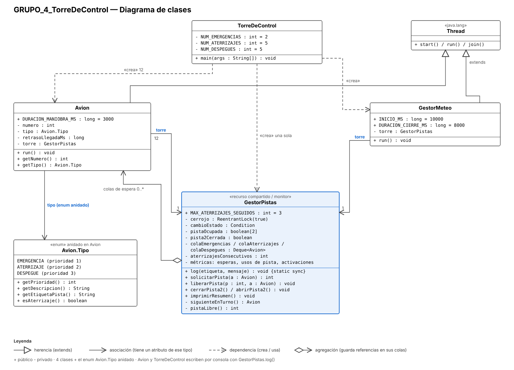
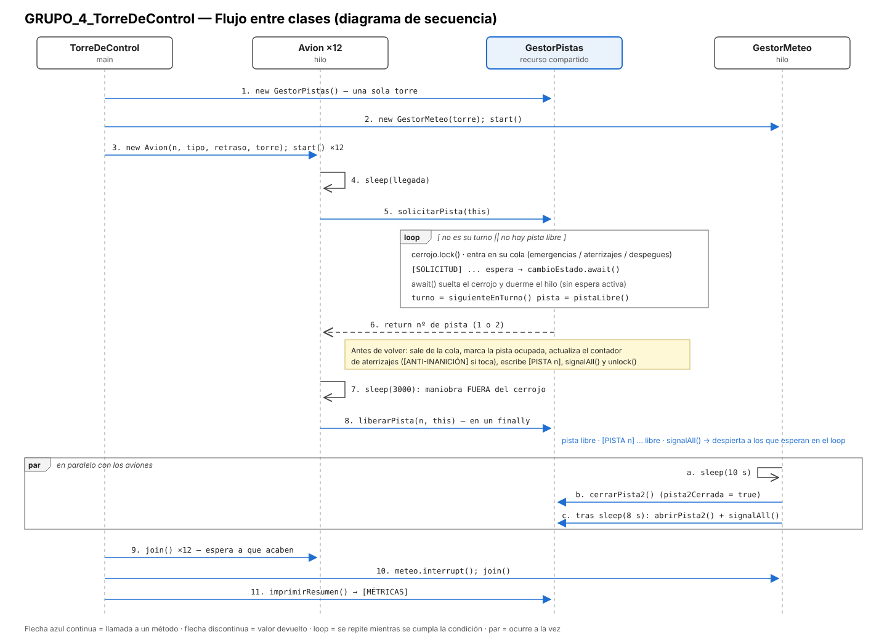
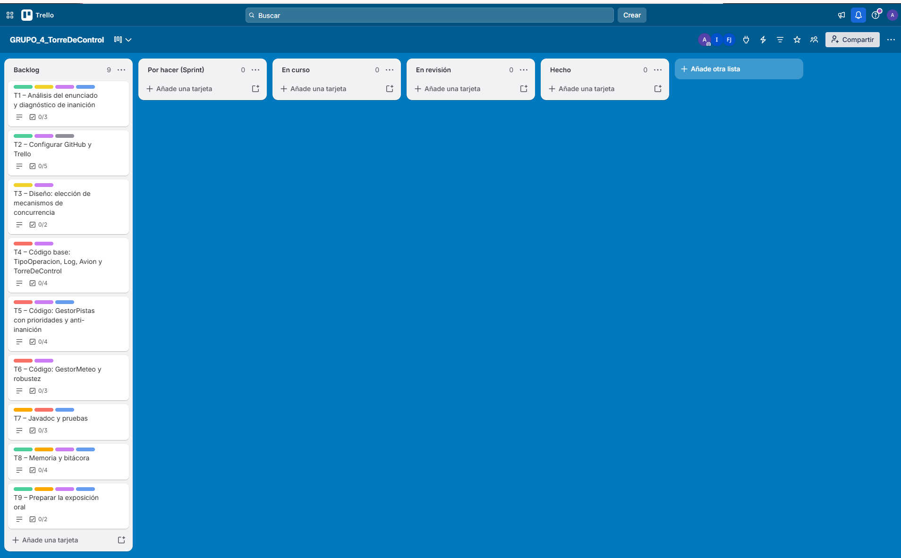
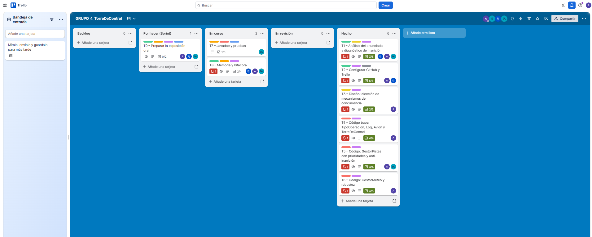

# GRUPO_4_TorreDeControl — Memoria

**Equipo de Torre de Control (Aeropuerto con Emergencias)**\
Integrantes: Iván, Alberto y Fabio — 2º DAM, PSP, UT2\
Repositorio Git: https://github.com/fabioporceldev/Grupo_4_TorreDeControl\
Tablero Trello: https://trello.com/b/O6XuzVoZ/grupo4torredecontrol

---

## 1. El problema

El aeropuerto tiene **2 pistas compartidas** por las que compiten **12 hilos `Avion`**. Cada maniobra dura **3 segundos**. Hay tres niveles de prioridad:

1. Aterrizaje de emergencia
2. Aterrizaje normal
3. Despegue

Hay dos reglas añadidas:

- **Anti-inanición:** tras 3 aterrizajes consecutivos, se deja salir al menos 1 despegue que esté esperando.
- **Evento meteorológico:** a los 10 s, el hilo `GestorMeteo` cierra la Pista 2 durante 8 s por viento cruzado.

## 2. Diagnóstico: por qué una cola de prioridad simple provoca inanición

Si metemos todas las peticiones en una cola de prioridad simple (por ejemplo, `PriorityBlockingQueue`), siempre sale primero el avión con mayor prioridad. Un despegue (prioridad 3) solo conseguiría pista cuando **no quedara ningún aterrizaje esperando**. Si los aterrizajes van llegando sin parar, el despegue no sale nunca, aunque las pistas se vayan liberando. Esto es **inanición (starvation)**: el hilo no está bloqueado por un error, pero nunca llega a ejecutar su trabajo porque siempre hay otro "más importante".

Por eso no dejamos la decisión a la cola, sino a un algoritmo propio (`siguienteEnTurno()`), que aplica la regla anti-inanición.

## 3. Diseño del gestor de pistas

### Clases

La solución tiene **4 clases**, una por cada elemento del problema, en el paquete `torrecontrol`:

| Clase | Qué es | Papel en la concurrencia |
|---|---|---|
| `TorreDeControl` | Clase principal (`main`) | Crea una sola torre, el meteo y los 12 aviones; los arranca con `start()`, espera con `join()` e imprime las métricas |
| `GestorPistas` | Monitor (recurso compartido) | Guarda todo el estado compartido, decide quién entra (prioridades y anti-inanición) y escribe los mensajes con `log()` |
| `Avion` | Hilo (`extends Thread`) | Llega, pide pista, hace la maniobra de 3 s y libera la pista. Contiene el `enum` anidado `Avion.Tipo` con las 3 prioridades |
| `GestorMeteo` | Hilo (`extends Thread`) | Cierra la Pista 2 a los 10 s y la reabre 8 s después |

En la primera versión había 6 clases: el `enum` de tipos y la utilidad de log eran clases aparte. Se integraron en `Avion` (el tipo es una característica del avión) y en `GestorPistas` (que es quien escribe casi todos los mensajes). El funcionamiento no cambia y el diseño queda con una clase por cada pieza del enunciado.

### Diagrama de clases



### Flujo entre clases

El diagrama de secuencia muestra qué clase llama a cuál y en qué orden, desde el `main` hasta el resumen de métricas:



### Estado compartido (dentro de `GestorPistas`)

- `boolean[] pistaOcupada`: qué pistas están en uso.
- `boolean pista2Cerrada`: si la Pista 2 está cerrada por el meteo.
- Tres colas FIFO (`ArrayDeque`): `colaEmergencias`, `colaAterrizajes` y `colaDespegues`.
- `int aterrizajesConsecutivos`: contador para la regla anti-inanición.
- Contadores de métricas: tiempos de espera por tipo, operaciones por pista y activaciones de la regla.

Todo este estado se lee y se modifica **solo dentro de las secciones críticas** de `GestorPistas`, con el cerrojo cogido.

### Mecanismos elegidos y por qué

- **`ReentrantLock(true)` (cerrojo justo):** protege todo el estado anterior. Cada método público de `GestorPistas` es una sección crítica completa (`lock()` al entrar y `unlock()` en un `finally`), así que no hay condiciones de carrera. Es *justo* (`fair`): los hilos consiguen el cerrojo en orden de llegada (equidad explícita). Lo elegimos frente a `synchronized` porque permite cerrojo justo y variables `Condition` explícitas.
- **`Condition cambioEstado`:** el avión que no puede entrar espera con `await()`, que libera el cerrojo y deja el hilo dormido sin gastar CPU (estado `WAITING`, sin espera activa). Cada vez que algo cambia (se libera una pista, entra un avión o se reabre la Pista 2) se hace `signalAll()` y cada avión vuelve a comprobar si le toca. La comprobación va siempre en un `while`, nunca en un `if`, porque al despertar hay que volver a verificar la condición.
- **Tres colas FIFO en vez de una de prioridad:** así se respeta el orden de llegada dentro de cada prioridad y se puede aplicar la regla anti-inanición. No usamos colas concurrentes porque solo se acceden con el cerrojo cogido.
- **Aforo de 2 pistas:** se controla con `pistaOcupada[]` y `pistaLibre()`. Podríamos haber usado un `Semaphore(2)`, pero necesitamos saber **qué** pista se asigna y poder cerrar una en concreto, y eso un semáforo no lo da.
- **`log()` `static synchronized`:** las líneas de dos hilos que escriben a la vez no se mezclan en la consola.

**Por qué no `ReadWriteLock`, `CyclicBarrier` ni `BlockingQueue`:** no hay lectores y escritores (`ReadWriteLock`), ningún avión espera a otro avión para avanzar a la vez (`CyclicBarrier`), y una `BlockingQueue` de prioridad provoca justo la inanición que hay que evitar.

### Flujo de un avión

1. `sleep(retraso)`: simula su llegada.
2. `solicitarPista()`: se mete en su cola. Si no es su turno o no hay pista libre, escribe `[SOLICITUD] ... espera` y hace `await()`.
3. Cuando le toca, sale de la cola, ocupa la pista, actualiza el contador y hace `signalAll()`.
4. `sleep(3000)`: la maniobra, **fuera del cerrojo**, para que la otra pista pueda usarse a la vez.
5. `liberarPista()` en un `finally`: la pista se libera siempre, aunque haya interrupción.

## 4. Algoritmo anti-inanición

`siguienteEnTurno()` decide quién entra:

1. Si hay **emergencias**, entra la primera emergencia.
2. Si ya ha habido **3 aterrizajes consecutivos** y hay algún despegue esperando, entra el primer despegue (`[ANTI-INANICIÓN]`).
3. Si no, entra el primer **aterrizaje normal**.
4. Si no hay aterrizajes, entra el primer **despegue**.

Cada aterrizaje (normal o de emergencia) suma 1 al contador, y cada despegue lo pone a 0.

**Decisión de diseño:** una emergencia nunca espera por la regla anti-inanición, porque la seguridad del avión en emergencia está por encima. Por eso a veces se ve "tras 4 aterrizajes consecutivos": la regla ya tocaba, pero llegó una emergencia y pasó primero. La inanición de los despegues sigue resuelta, porque en cuanto no hay emergencias el despegue entra.

## 5. Gestión del evento meteorológico y ausencia de interbloqueos

`GestorMeteo` duerme 10 s, llama a `cerrarPista2()`, duerme 8 s y llama a `abrirPista2()`.

- Cerrar la pista solo pone `pista2Cerrada = true` con el cerrojo cogido. El avión que ya estaba en la Pista 2 termina su maniobra, y a partir de ahí no se asigna a nadie más.
- Al reabrir se hace `signalAll()` para que los aviones que esperan aprovechen la Pista 2 enseguida.

**Por qué no hay interbloqueo (deadlock):**

- Solo hay **un cerrojo**, así que no puede haber espera circular entre cerrojos.
- **Nadie duerme con el cerrojo cogido**: las maniobras y las esperas del meteo se hacen fuera.
- La **Pista 1 nunca se cierra**, así que siempre habrá una pista que se libere y despierte a los que esperan.
- El meteo **no espera a ninguna pista**: no compite por ellas, solo cambia un estado.

## 6. Interrupciones

- Si un avión es interrumpido mientras espera en `await()`, sale de su cola, se hace `signalAll()` (porque puede cambiar quién va primero) y se relanza la excepción.
- Si es interrumpido durante la maniobra, el `finally` libera la pista igualmente.
- Al terminar los aviones, `main` interrumpe al meteo. Si la Pista 2 seguía cerrada, el `finally` del meteo la reabre.

## 7. Ejemplo de ejecución completa

```
[08:36:30] [TORRE] Inicio de la simulación: 12 aviones, 2 pistas.
[08:36:30] [PISTA 1] Avión #6 (Despegue) DESPEGANDO en Pista 1.
[08:36:32] [PISTA 2] Avión #4 (Despegue) DESPEGANDO en Pista 2.
[08:36:32] [SOLICITUD] Avión #1 (Despegue) espera. Cola: [Emergencias: 0, Aterrizajes: 0, Despegues: 1]
[08:36:32] [SOLICITUD] Avión #5 (Aterrizaje Normal) espera. Cola: [Emergencias: 0, Aterrizajes: 1, Despegues: 1]
[08:36:32] [SOLICITUD] Avión #11 (Despegue) espera. Cola: [Emergencias: 0, Aterrizajes: 1, Despegues: 2]
[08:36:32] [SOLICITUD] Avión #10 (Aterrizaje Normal) espera. Cola: [Emergencias: 0, Aterrizajes: 2, Despegues: 2]
[08:36:33] [PISTA 1] Avión #6 ha despegado. Pista 1 libre.
[08:36:33] [PISTA 1] Avión #5 (Aterrizaje Normal) ATERRIZANDO en Pista 1.
[08:36:34] [SOLICITUD] Avión #9 (Aterrizaje Normal) espera. Cola: [Emergencias: 0, Aterrizajes: 2, Despegues: 2]
[08:36:35] [PISTA 2] Avión #4 ha despegado. Pista 2 libre.
[08:36:35] [PISTA 2] Avión #10 (Aterrizaje Normal) ATERRIZANDO en Pista 2.
[08:36:35] [SOLICITUD] Avión #2 (Aterrizaje Normal) espera. Cola: [Emergencias: 0, Aterrizajes: 2, Despegues: 2]
[08:36:36] [SOLICITUD] Avión #12 (Despegue) espera. Cola: [Emergencias: 0, Aterrizajes: 2, Despegues: 3]
[08:36:36] [SOLICITUD] Avión #3 (Aterrizaje Normal) espera. Cola: [Emergencias: 0, Aterrizajes: 3, Despegues: 3]
[08:36:36] [PISTA 1] Avión #5 ha aterrizado. Pista 1 libre.
[08:36:36] [PISTA 1] Avión #9 (Aterrizaje Normal) ATERRIZANDO en Pista 1.
[08:36:38] [PISTA 2] Avión #10 ha aterrizado. Pista 2 libre.
[08:36:38] [ANTI-INANICIÓN] Priorizando despegue del Avión #1 tras 3 aterrizajes consecutivos.
[08:36:38] [PISTA 2] Avión #1 (Despegue) DESPEGANDO en Pista 2.
[08:36:39] [PISTA 1] Avión #9 ha aterrizado. Pista 1 libre.
[08:36:39] [PISTA 1] Avión #2 (Aterrizaje Normal) ATERRIZANDO en Pista 1.
[08:36:39] [ALERTA] ¡Avión #8 solicita ATERRIZAJE DE EMERGENCIA!
[08:36:39] [SOLICITUD] Avión #8 (Aterrizaje de Emergencia) espera. Cola: [Emergencias: 1, Aterrizajes: 1, Despegues: 2]
[08:36:40] [METEO] ¡ALERTA! Pista 2 CERRADA por viento cruzado. Operando solo con Pista 1.
[08:36:40] [METEO] El avión que está en la Pista 2 termina su maniobra; no se asignarán más.
[08:36:41] [PISTA 2] Avión #1 ha despegado. Pista 2 libre.
[08:36:42] [PISTA 1] Avión #2 ha aterrizado. Pista 1 libre.
[08:36:42] [PISTA 1] Avión #8 (EMERGENCIA) ATERRIZANDO en Pista 1.
[08:36:43] [ALERTA] ¡Avión #7 solicita ATERRIZAJE DE EMERGENCIA!
[08:36:43] [SOLICITUD] Avión #7 (Aterrizaje de Emergencia) espera. Cola: [Emergencias: 1, Aterrizajes: 1, Despegues: 2]
[08:36:45] [PISTA 1] Avión #8 ha aterrizado. Pista 1 libre.
[08:36:45] [PISTA 1] Avión #7 (EMERGENCIA) ATERRIZANDO en Pista 1.
[08:36:48] [METEO] Pista 2 REABIERTA. Operando con 2 pistas.
[08:36:48] [ANTI-INANICIÓN] Priorizando despegue del Avión #11 tras 3 aterrizajes consecutivos.
[08:36:48] [PISTA 2] Avión #11 (Despegue) DESPEGANDO en Pista 2.
[08:36:48] [PISTA 1] Avión #7 ha aterrizado. Pista 1 libre.
[08:36:48] [PISTA 1] Avión #3 (Aterrizaje Normal) ATERRIZANDO en Pista 1.
[08:36:51] [PISTA 2] Avión #11 ha despegado. Pista 2 libre.
[08:36:51] [PISTA 2] Avión #12 (Despegue) DESPEGANDO en Pista 2.
[08:36:51] [PISTA 1] Avión #3 ha aterrizado. Pista 1 libre.
[08:36:54] [PISTA 2] Avión #12 ha despegado. Pista 2 libre.
[08:36:54] [TORRE] Fin de la simulación: todos los aviones han operado.
[08:36:54] [MÉTRICAS] ------------------------------------------------------------
[08:36:54] [MÉTRICAS] Aterrizaje de Emergencia operaciones:  2 | espera media:   2.6 s | espera máx:   2.8 s
[08:36:54] [MÉTRICAS] Aterrizaje Normal        operaciones:  5 | espera media:   4.4 s | espera máx:  12.1 s
[08:36:54] [MÉTRICAS] Despegue                 operaciones:  5 | espera media:   7.4 s | espera máx:  15.9 s
[08:36:54] [MÉTRICAS] Uso de pistas -> Pista 1: 7 | Pista 2: 5
[08:36:54] [MÉTRICAS] Activaciones de la regla anti-inanición: 2
[08:36:54] [MÉTRICAS] ------------------------------------------------------------
```

En esta ejecución se ven todas las reglas: la regla anti-inanición adelanta al Avión #1 tras 3 aterrizajes; las emergencias #8 y #7 pasan por delante de los aviones que ya esperaban; mientras la Pista 2 está cerrada (de 08:36:40 a 08:36:48) solo se usa la Pista 1; y al reabrirla entra un despegue en ella enseguida.

## 8. Análisis de métricas

Al terminar, el programa imprime las métricas de la ejecución (`[MÉTRICAS]`). Para comprobar el efecto de la regla anti-inanición se hicieron **5 ejecuciones con la regla** y **5 sin ella** (la misma versión con `MAX_ATERRIZAJES_SEGUIDOS = 1000`, que en la práctica nunca se alcanza). Valores medios de las 5 ejecuciones:

| Tipo de maniobra | Espera media con regla | Espera media sin regla | Espera máxima con regla | Espera máxima sin regla |
|---|---|---|---|---|
| Aterrizaje de emergencia | 1,2 s | 1,7 s | 1,7 s | 2,1 s |
| Aterrizaje normal | 3,9 s | 3,2 s | 8,6 s | 6,8 s |
| Despegue | 8,2 s | 10,1 s | 15,5 s | 15,4 s |

En todas las ejecuciones con regla saltó al menos una vez (entre 1 y 2 activaciones), y el uso de pistas fue siempre de 7 operaciones en la Pista 1 y 5 en la Pista 2 (la Pista 2 está 8 s cerrada).

**Conclusiones:**

- Con la regla, las **emergencias** esperan siempre menos de 2,5 s: la prioridad máxima funciona.
- La regla **reparte la espera**: los despegues esperan de media un 19 % menos (de 10,1 s a 8,2 s) a cambio de que los aterrizajes normales esperen unos 0,7 s más.
- La **espera máxima** de los despegues apenas cambia porque la simulación es corta: los 12 aviones llegan en los primeros segundos y, sin regla, los despegues no se quedan sin salir, solo salen todos al final. La inanición de verdad aparece cuando los aterrizajes **siguen llegando sin parar**: sin la regla, un despegue esperaría indefinidamente; con ella, nunca espera más de 3 aterrizajes seguidos.

## 9. Problemas encontrados y cómo se resolvieron

- **IntelliJ marcaba las clases en rojo** porque el proyecto no tenía JDK definido. Se solucionó con *Setup SDK*, descargando el JDK.
- **El commit fallaba con *"Author identity unknown"*** en el ordenador de clase. Se configuró `git config user.name` y `user.email` sin `--global`, para no dejar los datos en un equipo compartido.
- **El proyecto estaba dentro de una carpeta que ya era un repositorio Git** (la de sincronización del curso). Se creó un repositorio propio en la carpeta del proyecto, enlazado al del grupo.
- **Se perdió la carpeta `.git`** al descomprimir una versión actualizada del proyecto encima de la original. Se reconectó con `git init`, `git remote add origin`, `git fetch` y `git reset origin/main`, sin perder archivos.
- **"Tras 4 aterrizajes consecutivos" en la salida:** parecía un fallo de la regla, pero es la decisión de diseño de que una emergencia pase siempre primero. Se documentó en el apartado 4.
- **Demasiadas clases para explicar:** la primera versión tenía 6 clases. Se integraron el `enum` de tipos en `Avion` y la utilidad de log en `GestorPistas`, dejando 4 clases sin cambiar el comportamiento.

## 10. BITÁCORA

Sprint de 5 días. El día 1 se documenta con una captura del tablero Trello al empezar y otra al terminar. Del día 2 al 5, con una captura al final del día.

### Día 1 — miércoles 25/11/2026

**Inicio del día:** tablero recién creado. Las 9 tarjetas del sprint (T1–T9) están en *Backlog* y las demás listas, vacías.



**Trabajo realizado:**

- **Todo el equipo:** lectura y análisis del enunciado, identificación de los requisitos y reparto de tareas. Se detecta el problema de inanición que provoca una cola de prioridad simple (T1).
- **Alberto:** crea el tablero Trello con las listas Scrum, las etiquetas y las 9 tarjetas del sprint (T2). Diseña la solución eligiendo `ReentrantLock` justo, `Condition` y tres colas FIFO (T3). Programa en IntelliJ la primera versión completa del simulador: `TipoOperacion`, `Log`, `Avion`, `TorreDeControl`, `GestorPistas` y `GestorMeteo` (T4, T5 y T6). Hace el primer commit y push desde VS Code.
- **Iván:** participa en el análisis del enunciado y en el reparto de tareas (T1).
- **Fabio:** crea el repositorio `Grupo_4_TorreDeControl` en GitHub, da permisos de push al equipo y lo comparte (T2).

**Problemas del día:**

- IntelliJ marcaba las clases en rojo porque el proyecto no tenía JDK definido. Se solucionó con *Setup SDK*, descargando el JDK.
- El commit fallaba con *"Author identity unknown"* en el ordenador de clase. Se solucionó con `git config user.name` y `git config user.email`, sin `--global` para no dejar los datos en un equipo compartido.
- El proyecto estaba dentro de la carpeta DAM2, que ya era un repositorio Git. Se creó un repositorio propio en la carpeta del proyecto (`git init`) enlazado al repositorio del grupo.

**Estado al terminar:** T1–T4 en *Hecho*; T5 y T6 en *En revisión* (código terminado, pendiente de revisión del equipo); T8 *En curso*; T7 y T9 en *Por hacer*.

**Fin del día:**


### Día 2 — jueves 26/11/2026

**Trabajo realizado:**

- **Todo el equipo:** revisión del código de `GestorPistas` y `GestorMeteo`. Las tarjetas T5 y T6 pasan de *En revisión* a *Hecho*. Se asigna a cada miembro en sus tarjetas de Trello.
- **Alberto:** revisa la solución con la rúbrica de evaluación y justifica la elección de `ReentrantLock(true)` + `Condition` frente a `PriorityBlockingQueue` y `Semaphore`. Elabora el diagrama de clases UML (incluido en el apartado 3) y un documento explicativo del funcionamiento de cada clase para preparar la exposición. Actualiza la memoria y la bitácora (T8).
- **Iván:** completa el Javadoc de las clases (T7, 1/3). Quedan pendientes las pruebas de ejecución.
- **Fabio:** mantiene el repositorio e integra en `main` los cambios de la memoria y la bitácora.

**Problemas del día:**

- Al descomprimir una versión actualizada del proyecto encima de la carpeta original se perdió la carpeta oculta `.git`. Se reconectó la carpeta al repositorio con `git init`, `git remote add origin`, `git fetch` y `git reset origin/main`, sin perder ningún archivo.
- Se descartaron los cambios en los archivos de configuración de IntelliJ (`.idea/misc.xml`, `vcs.xml`) para no romper la configuración del JDK de los compañeros.

**Estado al terminar:** T1–T6 en *Hecho*; T7 y T8 *En curso*; T9 en *Por hacer*.

**Fin del día:**



### Día 3 — dd/mm/2026

- **Alberto:** …
- **Iván:** …
- **Fabio:** …

**Fin del día:** *(captura pendiente)*

### Día 4 — dd/mm/2026

- **Alberto:** …
- **Iván:** …
- **Fabio:** …

**Fin del día:** *(captura pendiente)*

### Día 5 — dd/mm/2026

- **Alberto:** …
- **Iván:** …
- **Fabio:** …

**Fin del día:** *(captura pendiente)*
